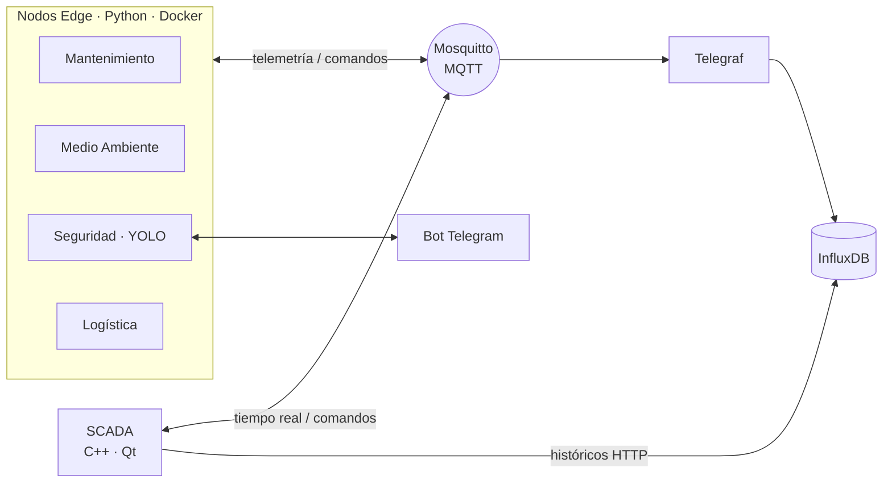

# ⛏️ SmartMine

**Sistema SCADA bidireccional y Edge Computing para minería subterránea (IIoT / Industria 4.0)**


> 🚧 **Proyecto en desarrollo.** Prueba de concepto (PoC) en construcción activa. La estructura y las funcionalidades pueden cambiar.

---

## 📖 Descripción

SmartMine simula la capa de supervisión y control de una mina de cobre de alto rendimiento. Nodos Edge independientes generan telemetría y reaccionan a comandos en tiempo real, mientras un dashboard SCADA de escritorio permite a los operadores supervisar la operación y actuar sobre ella.

## 🧩 Módulos

| Módulo | Función | Control desde el SCADA |
|---|---|---|
| 🔧 **Mantenimiento Predictivo** | Telemetría de maquinaria (temperatura, vibración...) | Parada individual por máquina |
| 🌫️ **Medio Ambiente** | Detección de anomalías (polvo, agua) | Activar aspersores de supresión |
| 🦺 **Seguridad Laboral** | Visión artificial (YOLO) para detección de EPIs | Permitir / Denegar acceso (UI y Telegram) |
| 🚛 **Logística Multiagente** | Simulación de camiones en un grid con rutas heurísticas | Asignar nueva tarea (Zona Norte/Sur) |

Además: **Parada de Emergencia Global**, control de acceso por roles (RBAC) y modo oscuro industrial.

## 🏗️ Arquitectura



## 🛠️ Stack tecnológico

| Capa | Tecnología |
|---|---|
| Infraestructura | Docker Compose |
| Mensajería | Eclipse Mosquitto (MQTT) |
| Históricos | InfluxDB 2.x + Telegraf |
| Nodos Edge | Python · Arquitectura Hexagonal |
| Visión artificial | OpenCV · YOLOv8 |
| Dashboard SCADA | C++ · Qt 6 · MVVM · QtCharts |
| Notificaciones | Telegram Bot API (Inline Keyboards) |

## 📁 Estructura del proyecto

```
SmartMine/
├── docker-compose.yml   # Orquestación de servicios
├── infra/               # Configuración de servicios de terceros
├── edge/                # Nodos Edge en Python
└── scada/               # Dashboard SCADA en C++/Qt
```

## 🗺️ Roadmap

**Fase 1 · Infraestructura y Core**
- [ ] Broker MQTT, InfluxDB y Telegraf con Docker Compose
- [ ] Proyecto base Qt con Qt MQTT
- [ ] Mock Login con filtrado de pestañas por rol
- [ ] Hoja de estilo QSS de modo oscuro industrial
- [ ] Bot de Telegram básico

**Fase 2 · Nodos Edge**
- [ ] Plantilla base hexagonal (Dominio, Puertos, Adaptadores)
- [ ] Nodo de Mantenimiento Predictivo
- [ ] Nodo de Medio Ambiente
- [ ] Nodo de Seguridad (YOLOv8 + Telegram)
- [ ] Nodo de Logística Multiagente
- [ ] Dockerización con recursos limitados

**Fase 3 · SCADA y bidireccionalidad**
- [ ] Pestañas de la UI con patrón MVVM
- [ ] Gráficas en tiempo real e históricos
- [ ] Mapa logístico con `QGraphicsView`
- [ ] Controles bidireccionales y Parada de Emergencia Global

## 🚀 Puesta en marcha

_Próximamente._

---

👤 **Autor:** Jesús David Calvente Zapata · [LinkedIn](https://www.linkedin.com/in/jcalvente083/) · [GitHub](https://github.com/jcalvente083)