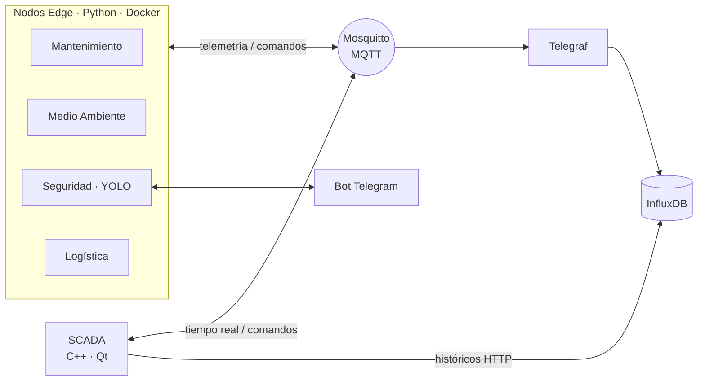

# ⛏️ SmartMine

**Sistema SCADA bidireccional y Edge Computing para minería subterránea (IIoT / Industria 4.0)**


> 🚧 **Proyecto en desarrollo.** Prueba de concepto (PoC) en construcción activa. La estructura y las funcionalidades pueden cambiar.

---

## 📖 Descripción

SmartMine simula la capa de supervisión y control de una mina de cobre de alto rendimiento. Nodos Edge independientes generan telemetría y reaccionan a comandos en tiempo real, mientras un dashboard SCADA de escritorio permite a los operadores supervisar la operación y actuar sobre ella.

## 🧩 Módulos

| Módulo | Función | Control desde el SCADA |
|---|---|---|
| 🔧 **Mantenimiento Predictivo** | Telemetría de maquinaria (temperatura, velocidad, par...) | Parada individual por máquina |
| 🌫️ **Medio Ambiente** | Detección de anomalías (polvo, agua) | Activar aspersores de supresión |
| 🦺 **Seguridad Laboral** | Visión artificial (YOLO) para detección de EPIs | Permitir / Denegar acceso (UI y Telegram) |
| 🚛 **Logística Multiagente** | Simulación de camiones en un grid con rutas heurísticas | Asignar nueva tarea (Zona Norte/Sur) |

Además: **Parada de Emergencia Global**, control de acceso por roles (RBAC) y modo oscuro industrial.

## 🏗️ Arquitectura



## 🛠️ Stack tecnológico

| Capa | Tecnología |
|---|---|
| Infraestructura | Docker Compose |
| Mensajería | Eclipse Mosquitto (MQTT) |
| Históricos | InfluxDB 2.x + Telegraf |
| Nodos Edge | Python · Arquitectura Hexagonal |
| Visión artificial | OpenCV · YOLOv8 |
| Dashboard SCADA | C++17 · Qt 6 (Widgets, MQTT) · MVVM |
| Notificaciones | Telegram Bot API (Inline Keyboards) |

## 📁 Estructura del proyecto

```
SmartMine/
├── docker-compose.yml   # Orquestación de servicios
├── docs/                # Documentación técnica
├── infra/               # Configuración de servicios de terceros
├── edge/                # Nodos Edge en Python
└── scada/               # Dashboard SCADA en C++/Qt
```

## 📚 Documentación

- [Contrato MQTT](docs/MQTT_TOPICS.md): jerarquía de topics, QoS y formato de los mensajes.
- [Arquitectura del SCADA](docs/SCADA_ARCHITECTURE.md): capas MVVM, servicios, RBAC y decisiones de diseño.
- [Preparación del entorno](docs/SETUP.md): instalación de Docker, Qt y compilación de Qt MQTT.

## 🗺️ Roadmap

**Fase 1 · Infraestructura y Core**
- [x] Broker MQTT, InfluxDB y Telegraf con Docker Compose
- [x] Healthchecks y arranque ordenado de la infraestructura
- [x] Contrato MQTT documentado (topics, QoS, enclavamiento de emergencia)
- [x] Proyecto base Qt con Qt MQTT
- [x] Servicio MQTT con reconexión automática (backoff exponencial)
- [x] Mock Login con filtrado de pestañas por rol
- [x] Cambio de usuario en vivo y confirmación de salida
- [x] Hoja de estilo QSS de modo oscuro industrial
- [x] Bot de Telegram básico

**Fase 2 · Nodos Edge**
- [ ] Plantilla base hexagonal (Dominio, Puertos, Adaptadores)
- [ ] Nodo de Mantenimiento Predictivo
- [ ] Nodo de Medio Ambiente
- [ ] Nodo de Seguridad (YOLOv8 + Telegram)
- [ ] Nodo de Logística Multiagente
- [ ] Dockerización con recursos limitados
- [ ] Modelo de ML (AI4I 2020) con explicabilidad SHAP en el nodo de Mantenimiento

**Fase 3 · SCADA y bidireccionalidad**
- [ ] Pestañas de la UI con patrón MVVM
- [ ] Gráficas en tiempo real e históricos
- [ ] Mapa logístico con `QGraphicsView`
- [ ] Controles bidireccionales y Parada de Emergencia Global
- [ ] Informe de diagnóstico en el SCADA (plantilla y SLM local con Ollama)

## 🚀 Puesta en marcha

Consulta la [guía de preparación del entorno](docs/SETUP.md).

## 📊 Datos

El nodo de Mantenimiento reproduce el *AI4I 2020 Predictive Maintenance Dataset*,
de S. Matzka (2020), publicado en el
[UCI Machine Learning Repository](https://archive.ics.uci.edu/dataset/601/ai4i+2020+predictive+maintenance+dataset)
bajo licencia [CC BY 4.0](https://creativecommons.org/licenses/by/4.0/).

---

👤 **Autor:** Jesús David Calvente Zapata · [LinkedIn](https://www.linkedin.com/in/jcalvente083/) · [GitHub](https://github.com/jcalvente083)