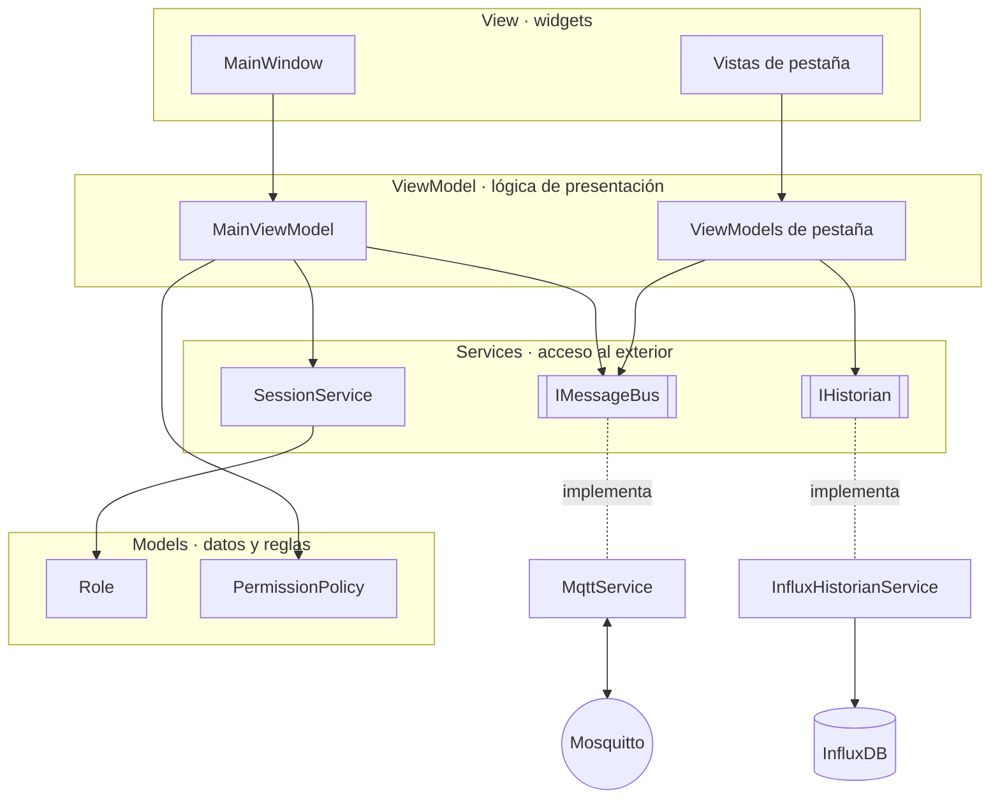
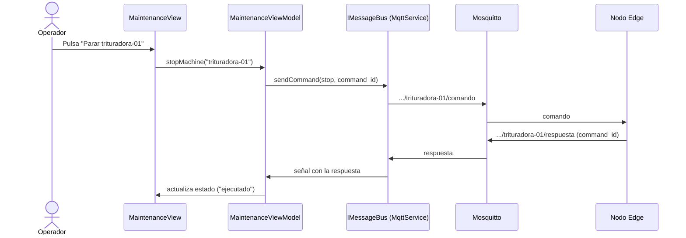

# 🏛️ Arquitectura del SCADA — SmartMine

Este documento describe la arquitectura del dashboard SCADA (C++ / Qt 6) y las decisiones de diseño que la sustentan.

> Los nombres de clases son provisionales y pueden ajustarse durante la implementación. Las **decisiones** de este documento no.

---

## 1. Visión general

El SCADA sigue el patrón **MVVM** (Model-View-ViewModel) sobre Qt Widgets. Las capas se comunican mediante **señales y slots**, de modo que ninguna operación de red bloquea la interfaz.



### Reglas de dependencia

| Capa | Conoce a | No conoce a |
|---|---|---|
| **View** | Su ViewModel | Servicios, MQTT, InfluxDB |
| **ViewModel** | Interfaces de servicios, Models | Widgets (`QLabel`, `QPushButton`…) |
| **Services** | Models, librerías externas | ViewModels, Views |
| **Models** | Nada del resto | Todo lo demás |

**Prueba de fuga:** si cambiar el protocolo de comunicación obliga a tocar una View, o cambiar un widget obliga a tocar un servicio, el diseño tiene una fuga.

---

## 2. Servicios

El SCADA solo se comunica con **dos sistemas externos**. Nunca habla directamente con los nodos Edge: todo pasa por el broker, lo que desacopla el SCADA del origen de los datos.

| Servicio | Interfaz | Sistema externo | Función |
|---|---|---|---|
| `MqttService` | `IMessageBus` | Mosquitto | Tiempo real, **bidireccional**: recibe telemetría, alertas, estados y respuestas; envía comandos. |
| `InfluxHistorianService` | `IHistorian` | InfluxDB | Histórico, **solo lectura**: consultas por rango de tiempo para las gráficas. |
| `SessionService` | — | — | Sesión simulada: guarda el rol actual y emite `roleChanged`. |

> *Historian* es el término estándar en SCADA para el sistema que almacena el histórico de datos de planta.

### 2.1. Interfaces

Los ViewModels dependen de **interfaces** (clases abstractas), nunca de implementaciones concretas. Esto permite:

- **Cambiar de tecnología** sin tocar los ViewModels; por ejemplo, añadir una implementación OPC UA de `IMessageBus`.
- **Probar los ViewModels** con implementaciones falsas que simulan mensajes, sin broker ni base de datos.

### 2.2. Una única conexión MQTT

La aplicación mantiene **una sola conexión** al broker, compartida por todos los ViewModels. Cada ViewModel solicita al servicio las suscripciones que necesita (por ejemplo, `smartmine/mantenimiento/#`) y el servicio distribuye los mensajes.

Motivos: un único identificador de cliente, un estado de conexión coherente para toda la aplicación, un único canal para la parada de emergencia y una sola implementación de la reconexión.

### 2.3. Gestión de la conexión

La reconexión es responsabilidad **exclusiva** de `MqttService`:

- Al detectar una desconexión, reintenta con **backoff exponencial**: 1 s, 2 s, 4 s… hasta un máximo de 30 s. El contador se reinicia al reconectar.
- Los reintentos usan temporizadores de Qt (`QTimer`), **nunca** esperas bloqueantes.
- Al reconectar, restaura automáticamente todas las suscripciones.

Los ViewModels conocen el **estado** de la conexión (señal de cambio de estado), pero no el **mecanismo** de reconexión.

### 2.4. Calidad del dato

Cuando se pierde la conexión, los valores en pantalla dejan de ser fiables. El SCADA lo hace visible:

- Los valores se muestran como **no actualizados** (por ejemplo, atenuados), para que el operador no confunda una lectura congelada con una lectura actual.
- Los botones de comando de los módulos se desactivan, ya que el comando no llegaría a su destino.
- Un indicador global muestra el estado de la comunicación con el broker.

---

## 3. Inyección de dependencias

Los servicios se crean **una sola vez** en `main.cpp`, que actúa como **raíz de composición**, y se pasan a cada ViewModel **por su constructor**.

Se descarta el patrón *singleton* porque oculta las dependencias, introduce estado global, impide sustituir los servicios en las pruebas y puede provocar problemas de orden de creación respecto a `QApplication`.

---

## 4. Control de acceso por roles (RBAC)

El SCADA incluye un **Mock Login**: un selector de rol sin autenticación real. La gestión de usuarios queda fuera del alcance de la PoC.

### 4.1. Roles y módulos visibles

| Rol | Mantenimiento | Medio Ambiente | Seguridad | Logística |
|---|:---:|:---:|:---:|:---:|
| **Jefe de Turno** | ✅ | ✅ | ✅ | ✅ |
| **SSMA** (Seguridad, Salud y Medio Ambiente) | | ✅ | ✅ | |
| **Mantenimiento** | ✅ | | | |
| **Logística** | | | | ✅ |

**Regla:** un rol puede ejecutar los comandos de los módulos que ve.

### 4.2. Implementación

- `SessionService` guarda el rol actual y notifica sus cambios.
- `PermissionPolicy` (Model) define qué módulos y acciones corresponden a cada rol. Está separada de la interfaz: cambiar los permisos no obliga a tocar ningún widget.
- `MainWindow` reacciona a `roleChanged` mostrando u ocultando las pestañas según la política.

---

## 5. Parada de emergencia

| Acción | Quién | Motivo |
|---|---|---|
| **Parada de emergencia** (`estop`) | **Todos los roles** | Quien detecta un peligro debe poder parar al instante, sin depender de permisos. |
| **Rearme** (`reset`) | **Solo Jefe de Turno** | Un responsable debe verificar que la causa se ha resuelto antes de rearmar. |

La asimetría es deliberada (**diseño a prueba de fallos**): parar es fácil y está al alcance de todos; rearmar requiere responsabilidad.

- La seta **no pertenece a ninguna pestaña**: está en la ventana principal, siempre visible y activa, de modo que ningún filtro por rol puede ocultarla.
- El enclavamiento (`Retain=True` en `estop` y `reset`) está definido en el [contrato MQTT](MQTT_TOPICS.md).

> ⚠️ **Alcance:** la parada de emergencia del SCADA es una **función de control**, no una función de seguridad certificada. En una instalación real, la parada de emergencia de seguridad es cableada e independiente del software (ISO 13850).

---

## 6. Flujo de un comando

Ejemplo: un técnico de mantenimiento detiene una máquina.



El ViewModel correlaciona la respuesta con el comando enviado mediante el `command_id` (UUID v4), según el [contrato MQTT](MQTT_TOPICS.md).

---

## 7. Estructura de carpetas

```
scada/
├── CMakeLists.txt
├── CMakePresets.json
├── src/
│   ├── main.cpp        # Raíz de composición
│   ├── models/         # Tipos de datos y reglas (roles, permisos)
│   ├── services/       # Interfaces e implementaciones (MQTT, historian, sesión)
│   ├── viewmodels/     # Un ViewModel por pestaña + MainViewModel
│   └── views/          # MainWindow y vistas de pestaña
├── resources/          # Hoja de estilo QSS, iconos
└── tests/              # Pruebas de ViewModels con servicios falsos
```

---

## 8. Registro de decisiones

| # | Decisión | Alternativa descartada | Motivo |
|---|---|---|---|
| 1 | Dos servicios externos (MQTT e historian) | Comunicación directa con cada nodo | Desacoplamiento mediante el broker |
| 2 | Una única conexión MQTT | Una conexión por pestaña | Estado coherente, un solo identificador, una sola reconexión |
| 3 | Inyección de dependencias por constructor | Singleton | Dependencias explícitas y servicios sustituibles en pruebas |
| 4 | Interfaces delante de los servicios | Dependencia directa de las implementaciones | Cambio de tecnología y pruebas sin infraestructura |
| 5 | Reconexión encapsulada en `MqttService` | Gestión en cada ViewModel | Responsabilidad única; los ViewModels solo ven el estado |
| 6 | Calidad del dato visible al perder la conexión | Mostrar el último valor sin más | Evitar que el operador confunda datos congelados con datos actuales |
| 7 | RBAC con política de permisos separada de la UI | Lógica de permisos en los widgets | Cambiar permisos sin tocar la interfaz |
| 8 | Parada de emergencia para todos, rearme solo para el Jefe de Turno | Parada restringida por rol | Principio de seguridad: cualquiera puede parar ante un peligro |